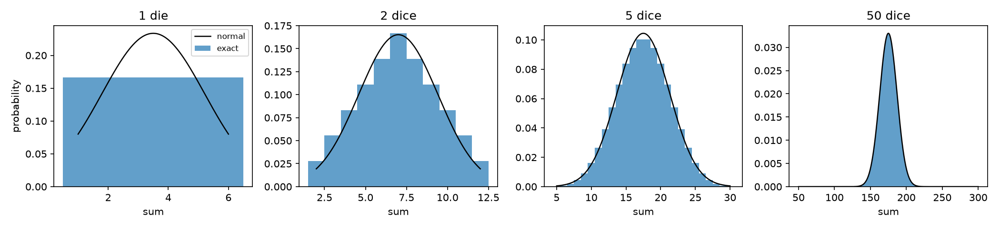
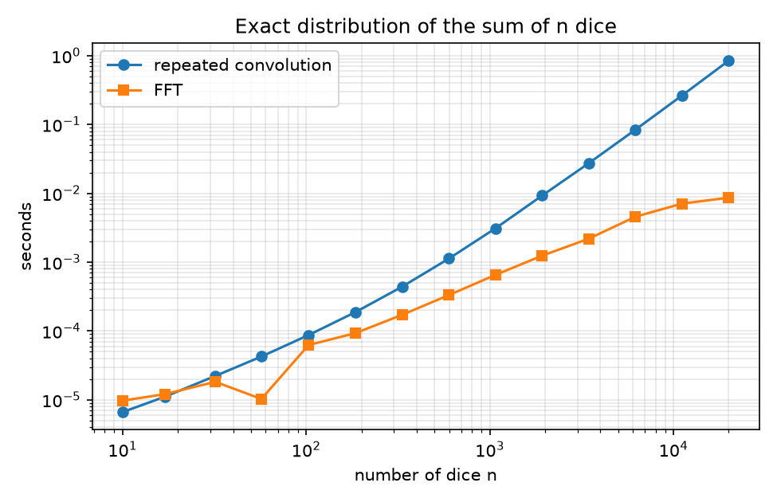
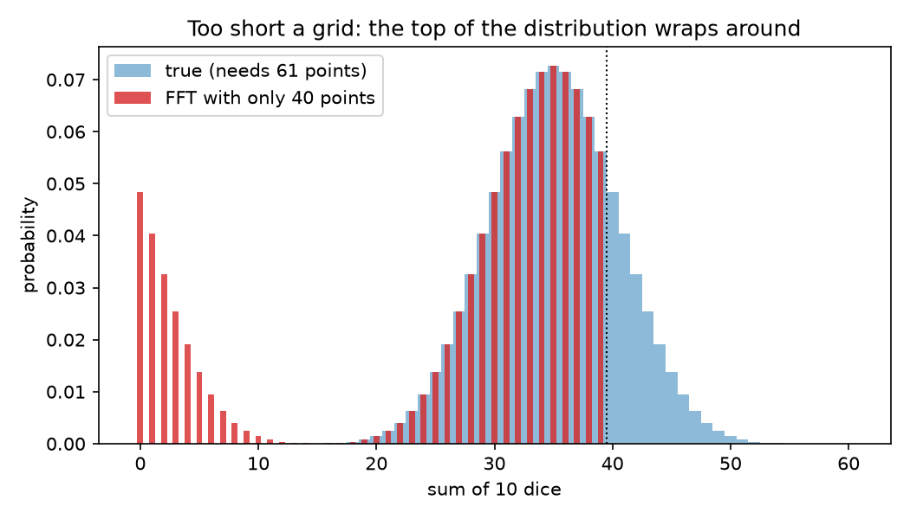
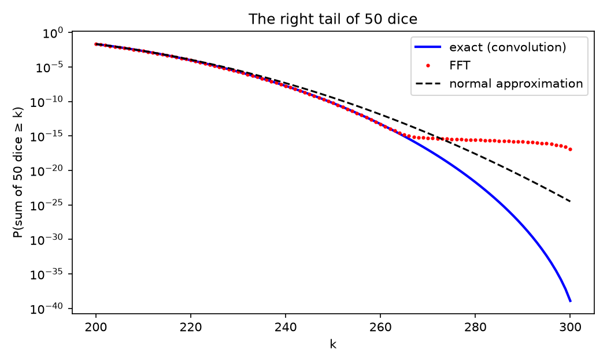

# Dice, Fourier and the shape of a sum

**Question:** what is the *exact* distribution of the sum of 50 dice, what's the fastest way to compute it, and how wrong is the bell curve?

## The idea

The sum of two independent dice has the convolution of their distributions. So one way to get n dice is to convolve n times. That works but the problem is that the cost grows like n²

The other way goes through Fourier! The characteristic function of a random variable, φ(t) = E[e^{itX}] which essentially turns sums into products: if S = X₁ + … + Xₙ with independent, identical Xᵢ, then φ_S(t) = φ(t)ⁿ. The FFT of the die's probability vector *is* its characteristic function sampled on a grid. So I take the FFT once raise it to the n-th power, and invert. That costs about n log n.

I wanted to see three things: how much faster it really is, what goes wrong if you're careless, and what the exact answer says about the normal approximation

## What I found

**1. The bell curve shows up fast, at least in the middle.** By 5 dice the normal curve is already hard to tell apart by eye.



**2. The FFT is about 124× faster at 20,000 dice.** On a log-log plot, the time for repeated convolution has slope 1.99 (it really is n²), while the FFT's slope is 1.02.



**3. The FFT grid has to be big enough, or the distribution wraps around.** The sum of 10 dice runs from 10 to 60, so it needs 61 grid points. With only 40, the mass above 39 doesn't disappear; it lands on top of the low sums. I checked that the "wrong" answer is exactly the true distribution folded around a circle of 40 points (they agree to 3e-17). The FFT secretly lives on a circle.



**4. In the tails, the normal approximation and the FFT both fail, for different reasons.**

| | exact | normal approx. | normal / exact |
|---|---|---|---|
| P(S ≥ 225) | 1.6e-5 | 2.1e-5 | 1.3 |
| P(S ≥ 250) | 5.8e-11 | 3.4e-10 | 5.9 |
| P(S ≥ 275) | 6.2e-20 | 8.7e-17 | about 1,400 |
| P(S ≥ 300) | 1.2e-39 | 3.2e-25 | about 10¹⁴ |

- The normal approximation is decent in the middle but overstates the far tail by orders of magnitude. Dice can't go above 6, and a normal distribution doesn't know that.
- The FFT matches the exact answer to within 5e-17 everywhere, but that's an *absolute* error. Once the true tail probability drops below about 1e-15 the FFT is just showing rounding noise (the flat red dots).
- Repeated convolution only ever adds and multiplies positive numbers, so it keeps its *relative* accuracy all the way down. It correctly gets P(all fifty dice show 6) = (1/6)⁵⁰ ≈ 1.2e-39



So the fast method has a floor, and the slow method doesn't. That trade-off is the part I didn't expect.

## Why I care

    I thought of this because when we look at the price of an asset over a month it is also a sum of many small random moves. For many models of returns the density has no simple formula, but the characteristic function does, and option prices can be computed with exactly this FFT trick (Carr and Madan, 1999), which i came across recently. In essence, the same two warnings carry over: the grid has to be wide enough, and far out-of-the-money prices sit in the tail, where the FFT's noise floor lives 

## Run it

```
python src/shapes_and_tails.py
python src/timing.py
python src/wraparound.py
```

Run from this folder. It needs numpy, scipy and matplotlib. Timings will differ on other machines, but the slopes shouldn't.
