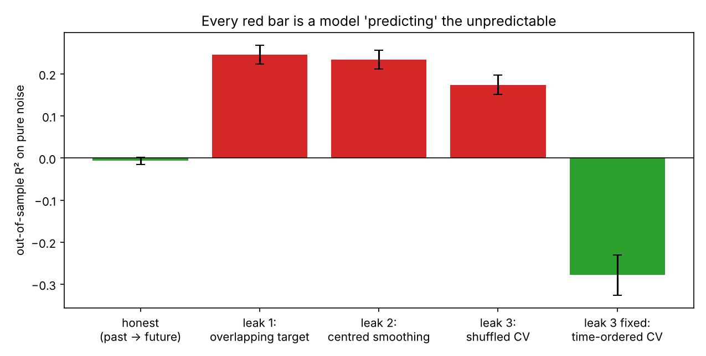
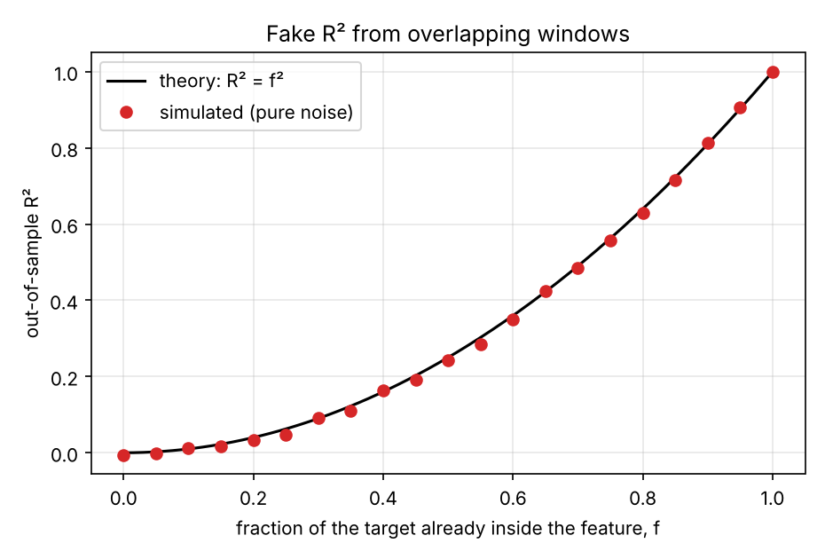

# The leakage hunter: getting R² = 0.25 out of pure noise

**Question:** how much predictive power can a forecasting pipeline "find" in data that has none?

## Why I built this

In my [Bitcoin volatility project](https://github.com/sarahrassool15/btc-volatility-forecasting), I found that about 82% of my original 5-minute R² came from the target window overlapping the feature window. The model wasn't predicting the future; part of the "future" was already in its inputs. Nothing about the result looked wrong at the time. It just looked good.

So I wanted a test that catches this kind of mistake *before* I believe a result. On real data you can't, because you never know how much signal is really there. On pure noise you do: the right answer is zero. Any pipeline that scores above zero on noise is leaking.

## The setup

Returns are independent standard normals, 20,000 of them. Every pipeline forecasts the sum of the next 20 returns, which is unpredictable by construction. I score each pipeline out of sample, averaged over 20 fresh noise samples.

- **Honest:** feature = the last 20 returns, target = the next 20, train on the first 70%, test on the rest.
- **Leak 1, overlapping target:** the target is shifted forward by 10 instead of 20, so half of it is already inside the feature. One wrong number.
- **Leak 2, centred smoothing:** the feature is a 21-period moving average with `center=True`, which quietly uses 10 future returns.
- **Leak 3, shuffled cross-validation:** the features are honest (slow, past-only moving averages), but shuffled k-fold puts neighbouring days in both train and test. Their targets share 19 of 20 returns, and the slow features act like a timestamp, so a nearest-neighbour model "predicts" a test day by remembering the day next to it.
- **Leak 3 fixed:** the same model and features, with time-ordered folds and a 20-period gap.

## What I found



| Pipeline | R² on pure noise |
|---|---|
| Honest | −0.007 |
| Leak 1: overlapping target | **+0.246** |
| Leak 2: centred smoothing | **+0.235** |
| Leak 3: shuffled CV | **+0.174** |
| Leak 3 fixed: time-ordered CV | −0.278 |

Three ordinary-looking choices each produce R² around 0.2 from nothing.

The last bar is the one I find most useful. The fixed version scores *worse* than zero, because a flexible model fitted to noise is genuinely worse than predicting the average, and honest testing says so. The shuffled version hid that and reported a gain. The gap between −0.28 and +0.17 is entirely leakage.

**The overlap leak has an exact formula.** If a fraction f of the target's returns are already in the feature, then with independent, equal-variance returns the correlation is exactly f, so the fake R² is f². Simulation matches it across every amount of overlap:



The centred-smoothing leak works the same way. Ten of the 21 smoothed returns sit inside the 20-return target, so the formula gives 10² / (21 × 20) = 0.238. I measured 0.235.

## What I take from it

- Run a placebo test on noise before trusting any R². It takes a minute.
- A result that looks good and has no exact explanation deserves more suspicion, not less.
- A model that knows the future through its inputs doesn't look broken. It looks excellent, which is why this mistake is easy to make and hard to see.

## Run it

```
python src/hunter.py          # placebo test of all five pipelines
python src/overlap_curve.py   # fake R² against overlap, with theory
```

Run from this folder. It needs numpy, pandas, scikit-learn and matplotlib.
