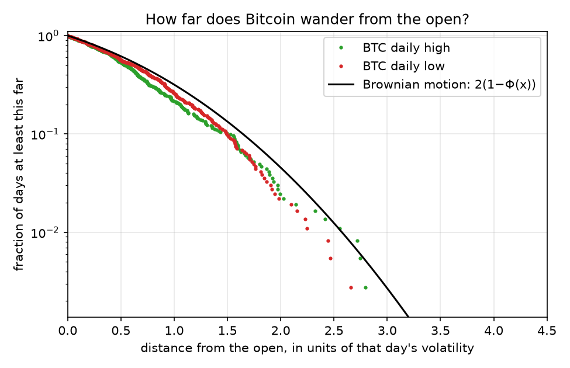
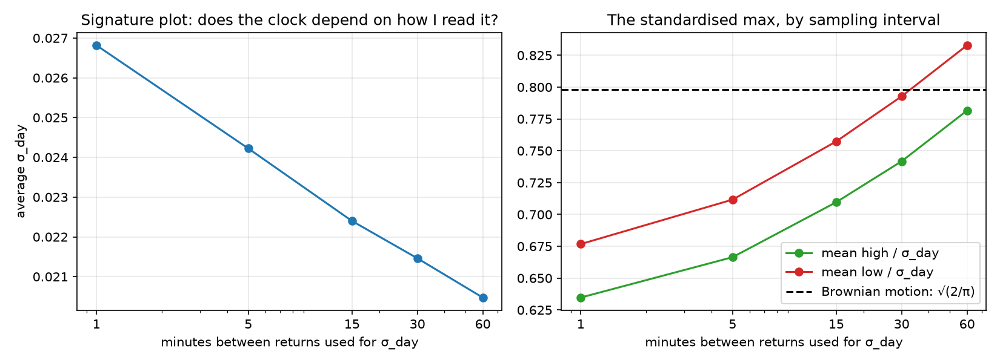
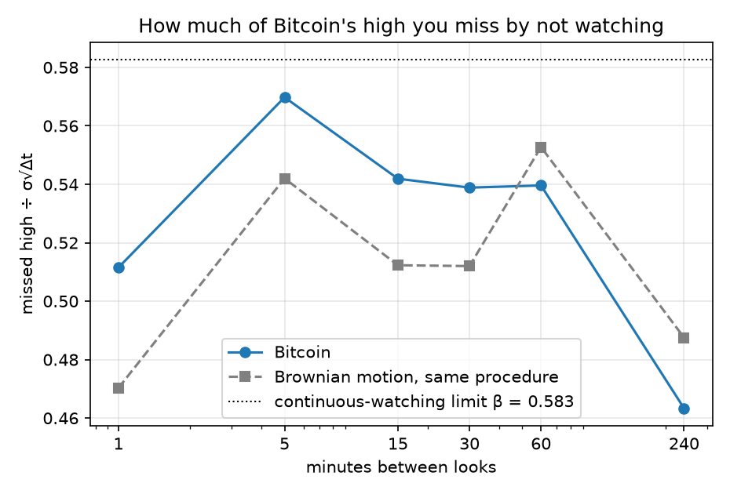

# Does Bitcoin's maximum behave like Brownian motion's?

Brownian motion sits under almost everything in this field, from stochastic calculus to Black-Scholes to every pricing model I've worked with. So I learned it properly, the definition, the square root of time scaling and the proofs. At some point I realised I had never checked whether any of it was true of a real market. It felt like learning the rules of a game and never playing it.

The first market I thought of was Bitcoin. It trades all day every day with no official open or close, so it is about as close as a real market gets to a continuous path, which is what Brownian motion is meant to be. It also has a reputation for being badly behaved. If the textbook model breaks anywhere it should break there.

Then I had to decide what to test. The prediction I kept coming back to was the reflection principle. If a path touches some level and ends below it, you can flip everything after the first touch and get an equally likely path that ends above it. That means the chance the maximum reaches a level is twice the chance the price ends above it. It gives one clean number to check. Measured in units of volatility, the daily maximum should behave like the absolute value of a standard normal, with an average of about 0.80. Every day of Bitcoin trading gives me one maximum to compare.

The first problem was that Bitcoin's volatility changes every day, so one number can't describe a quiet Sunday and a crash. I got around it by thinking of volatility as the speed of a clock and measuring each day by its own realised volatility, worked out from 5 minute returns. If Bitcoin is Brownian motion running on a faster or slower clock, the daily high divided by that day's volatility should look the same on every kind of day.

The second problem came up while I was setting this up. I only see the price at fixed times, so the true high can happen between my looks. There is a result for that too. On average you miss about 0.58 times the volatility over the gap between looks, and that 0.58 comes from the Riemann zeta function, which I did not expect to see in a question about prices.

That left me with the question for this project. How far does Bitcoin wander from where it opens each day, measured on its own clock, and is that what Brownian motion predicts?

## Checking the tools first

Before using real data I checked both results by simulation in src/simulation.py. Then I ran every script on fake Bitcoin made from pure Brownian motion, where I know the right answer, and got an average of 0.79 to 0.81 against 0.80. Only after that did I use a year of 1 minute BTC/USDT candles from Binance US, from 1 November 2025 to 1 November 2026, which gave 364 complete days.

## My prediction, and what actually happened

I expected Bitcoin to wander **further** than Brownian motion. It has jumps, fat tails, and a reputation.

It wanders **less**.



| | Bitcoin high | Bitcoin low | Brownian motion |
|---|---|---|---|
| Mean of max ÷ σ_day | 0.666 | 0.712 | 0.798 |
| Days at least 2σ away | 2.2% | 1.9% | 4.6% |

## Why: the clock was running too fast

My suspicion was the denominator, not the maximum. $\sigma_{\text{day}}$ adds up every little wiggle. If the price keeps bouncing back and forth, the wiggles pile up in $\sigma_{\text{day}}$ but the price doesn't actually *get* anywhere. Every day then looks tamer than it is.

There's a clean test for that. Under Brownian motion, (close − open) ÷ $\sigma_{\text{day}}$ must have a standard deviation of **exactly 1**. Bitcoin's is **0.820**. That's the same shortfall as the maximum (0.666 / 0.798 = 0.83). So $\sigma_{\text{day}}$ overstates how far Bitcoin really travels by about 20%.

The signature plot confirms it. If I compute $\sigma_{\text{day}}$ from returns sampled less often, fewer bounces get counted:

| Returns used for σ_day | 1 min | 5 min | 15 min | 30 min | 60 min |
|---|---|---|---|---|---|
| Average σ_day | 2.68% | 2.42% | 2.24% | 2.15% | 2.05% |
| Mean high ÷ σ_day | 0.635 | 0.666 | 0.710 | 0.742 | 0.782 |
| Std of close ÷ σ_day | 0.790 | 0.820 | 0.856 | 0.881 | 0.907 |

For Brownian motion, all of these rows would be flat (on the fake data, σ_day stayed at about 0.032 whatever the interval). For Bitcoin, the "same" day's volatility comes out about 30% higher measured at 1 minute than at 60. That's the signature of short-term bounce-back: bid-ask bounce and quick reversals.



## The twist: once the clock is fixed, the lows still run further

Rescaling by the 0.820 puts the clock right. Then:

| | Bitcoin high | Bitcoin low | Brownian motion |
|---|---|---|---|
| Mean of max ÷ σ_day, rescaled | 0.813 | **0.868** | 0.798 |

The highs now look almost exactly like Brownian motion. The lows still go about 9% further. Brownian motion is symmetric (minus a Brownian motion is a Brownian motion), so it can't do that. And it isn't drift: the average close ÷ σ_day is −0.019, basically zero. Within a day, Bitcoin falls further than it rises, relative to its own volatility. My guess is that volatility rises when the price falls, which stretches the downside. That's for a later project.

## Missing the high



| Look every | 1 min | 5 min | 15 min | 30 min | 60 min | 240 min |
|---|---|---|---|---|---|---|
| Bitcoin | 0.512 | 0.570 | 0.542 | 0.539 | 0.540 | 0.463 |
| Brownian motion, same procedure | 0.470 | 0.542 | 0.512 | 0.512 | 0.553 | 0.488 |

Even perfect Brownian motion doesn't reach β = 0.583 here, because that's the limit for watching continuously. So I compare against Brownian motion pushed through exactly the same steps.

Looking every 1 to 30 minutes, I miss more of Bitcoin's high than Brownian motion's: about 9% more at 1 minute. That fits sharp spikes *inside* a minute that the closing prices never show. And since this is divided by the same overstated $\sigma_{\text{day}}$, the real excess is, if anything, bigger.

## What I take from it

- My prediction was wrong, but for an interesting reason: **the problem was the ruler, not the thing I was measuring.** A volatility estimate is a measurement with its own biases, and it depends on how often you read it.
- Brownian motion gets Bitcoin's *highs* almost exactly right, once the clock is right. It gets the *lows* wrong.
- Same lesson as my last project: check the method on fake data where you know the answer, *then* trust what it says about real data.

## Limits

One year, one exchange, 364 days, so "2% of days" is only about 8 days. Rescaling by 0.820 is a blunt fix that uses the same data it's correcting. And Binance US is a small share of global Bitcoin volume.

## Run it

```
python src/fetch_data.py      # one year of 1-minute candles, about 5 minutes
python src/simulation.py      # the two Brownian motion facts, by simulation
python src/btc_max.py         # Bitcoin vs Brownian motion
python src/diagnose.py        # why: the close test and the signature plot
```

Run from this folder. It needs numpy, pandas, scipy, matplotlib and requests. Each analysis script also takes a file path, so it runs on any candle file with the same columns.
