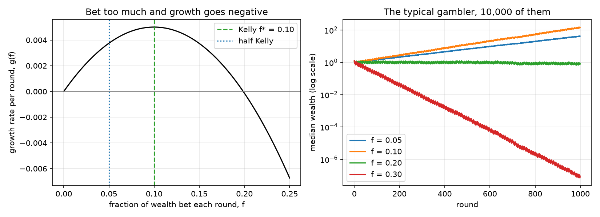
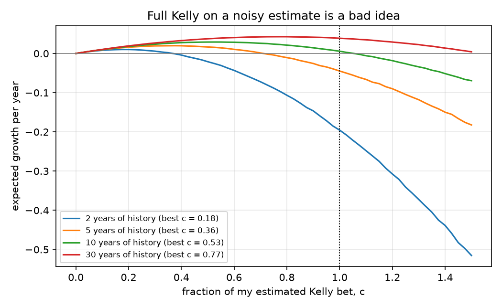
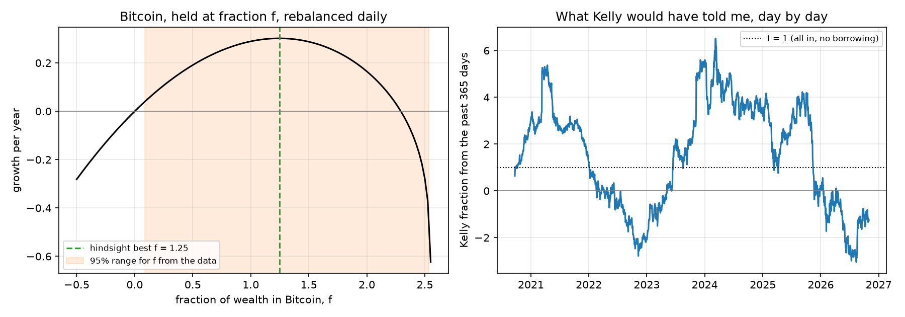

# Kelly betting, and why traders bet half

My last project used log returns a lot, and it made me think about the fact that wealth multiplies rather than adds. A 50% loss followed by a 50% gain leaves you down 25%. That led to a simple question. If each bet multiplies what you have, how much should you risk?

The standard answer is the Kelly criterion. I wanted to work through it properly, starting with a biased coin and then moving to a real asset. Along the way I kept seeing the claim that traders bet about half of what Kelly suggests, so I also wanted to see whether there was a reason for that beyond caution. Then I tried it on Bitcoin.

## Part 1: a biased coin

The coin lands heads 55% of the time, and each round I bet a fraction f of my wealth at even money. Taking logs, the growth rate per round is

$$g(f) = p\log(1+f) + (1-p)\log(1-f).$$

Setting $g'(f) = 0$ gives $f^* = 2p - 1 = 0.10$.



10,000 simulated gamblers over 1,000 rounds:

| Fraction bet | Median final wealth | Mean final wealth |
|---|---|---|
| 0.05 (half Kelly) | 42.6 | 149 |
| 0.10 (Kelly) | 149.7 | 19,718 |
| 0.20 (double Kelly) | 0.87 | 8,132,309 |
| 0.30 | 0.00 | 289,276 |

The mean keeps rising with f, but that's driven by a few very lucky paths. The median, which is what a typical gambler gets, peaks at Kelly and falls to zero by 0.30. Half Kelly keeps about 75% of the growth, and double Kelly gives roughly zero. Also, every gambler betting the full Kelly fraction dropped to half of an earlier peak at some point.

## Part 2: why bet half

For an asset with drift μ and volatility σ, the Kelly fraction is $f^* = \mu/\sigma^2$ and the growth from holding a fraction f is $g(f) = \mu f - \sigma^2 f^2/2$. In practice μ has to be estimated. If I bet a fraction c of a noisy estimate $\hat f$ that is right on average with variance v, the expected growth is maximised at

$$c^* = \frac{f^{*2}}{f^{*2} + v}.$$

When the noise is about the same size as the edge, $c^* = 1/2$. So half Kelly is what you'd choose if you're honest about how uncertain your estimate is.

Simulation on a made-up asset with 20% drift and 60% volatility:

| Years of history | Noise ÷ edge | Best c, simulated | Best c, formula |
|---|---|---|---|
| 2 | 2.12 | 0.18 | 0.18 |
| 5 | 1.34 | 0.38 | 0.36 |
| 10 | 0.95 | 0.53 | 0.53 |
| 30 | 0.55 | 0.78 | 0.77 |



## Part 3: Bitcoin

Daily BTC/USDT from Binance US, 23 September 2019 to 31 October 2026 (2,595 returns, about 7.1 years).

| | |
|---|---|
| Average return | 47.3% per year |
| Volatility | 60.1% per year |
| Kelly fraction μ/σ² | 1.31 |
| Standard error of the average return | 22.5% per year |
| 95% range for the Kelly fraction | 0.09 to 2.54 |



Taken at face value, Kelly says hold 131% of wealth in Bitcoin. But the uncertainty is large. The error in an average return shrinks with the square root of the number of years, so seven years isn't enough to narrow it much, and using more frequent data wouldn't help.

A few other things I noticed:

- The growth curve is flat near the top. The best fraction in hindsight was 1.25 (30.2% a year), compared with 28.9% for holding 100% Bitcoin.
- The worst day was −39.1%, so any fraction above 2.6 would have been wiped out that day. The upper end of the 95% range, 2.54, is just below that.
- Using only the previous 365 days, the Kelly fraction ranged from −3.04 to 6.52 depending on when you looked.
- The shrinkage formula gives c = 0.82, so f ≈ 1.07, close to just holding Bitcoin without leverage. This is rough, since it treats the noisy estimate as the true value.

## Summary

Kelly is only optimal if you know your edge, and in practice you don't. The noisier your estimate, the less of Kelly you should bet. For Bitcoin, seven years of data leave the right answer very uncertain.

## Limits

The sample is one period of Bitcoin history and not a forecast. The shrinkage result assumes volatility is known and returns are normal, and Bitcoin's tails are heavier than that. Borrowing costs, fees and leverage limits are ignored.

## Run it

```
python src/fetch_data.py
python src/coin_flip.py
python src/shrinkage.py
python src/btc_kelly.py
```

Run from this folder. Needs numpy, pandas, matplotlib and requests.
