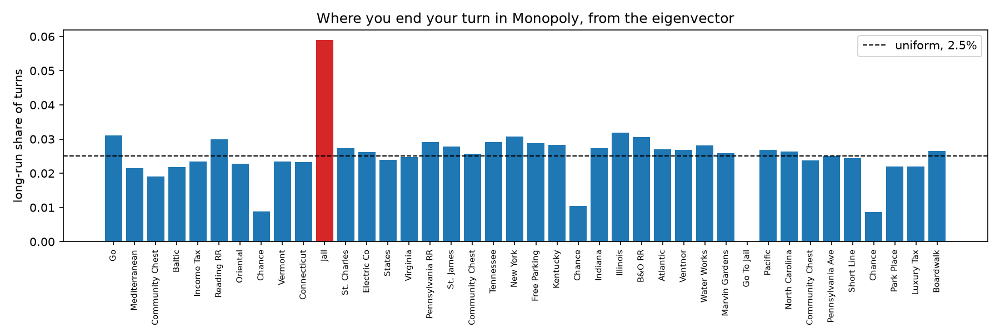
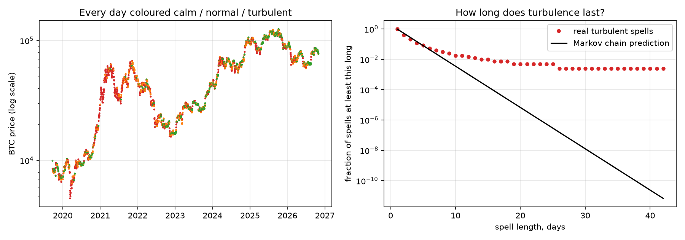

# From Monopoly to market regimes

Bitcoin's volatility seems to come in stretches. It stays calm for a while and then it doesn't. The simplest model for that is a Markov chain, where tomorrow only depends on today. I had never actually built one, so I tried it on Monopoly first and then on Bitcoin to see whether Bitcoin behaves like one.

## Monopoly

Your next square only depends on where you are and what you roll, so the whole game fits in one 40 by 40 matrix. The share of time spent on each square in the long run is the eigenvector of that matrix with eigenvalue 1.



Jail comes out on top at about 5.9 percent, compared with 2.5 percent for an ordinary square. After that come Illinois, Go, New York and the B&O railroad, all at around 3 percent. A simulated game of a million turns agreed with the eigenvector almost exactly. The second eigenvalue is 0.84, which means the board half forgets where you started after about four turns.

## Bitcoin

I used daily Bitcoin prices from Binance US from September 2019 to October 2026 and labelled each day as calm, normal or turbulent based on how far the price moved between its high and low. The cut-offs were set using the whole sample, so this is a description of the past and not a forecast.

A calm day is followed by another calm day about half the time, and the same is true for turbulent days. If days were independent that would be one in three. Treated as a Markov chain, this says the market forgets which regime it was in within a day. That turned out not to be true.



Turbulent stretches last a little over two days on average, which the Markov chain gets right, but the shape is wrong. There are more one-off turbulent days than it expects and many more long stretches. About four times as many stretches reach ten days as the chain predicts, and the longest one lasted 42 days, which the chain says should almost never happen.

The more direct test is whether yesterday matters once you already know today. In a Markov chain it shouldn't. When today and yesterday were both turbulent, tomorrow was turbulent 65 percent of the time. When only today was turbulent, it was 40 percent. That gap is far too large to be chance. I ran the same test on fake data from a real Markov chain first and it found nothing, so it isn't a problem with the method.

So Bitcoin isn't a Markov chain, at least not with these three states. One turbulent day is often just a blip, but two in a row usually means something longer is happening. That matches the long memory in volatility I found in an earlier project. A hidden Markov model is probably the next thing to try.

## Limits

Three states is a rough way to describe volatility, and the results depend on where the cut-offs are. This is one exchange over one seven year period. The Monopoly version draws cards at random each time instead of from a deck and skips the rule about rolling three doubles.

## Run it

```
python src/fetch_data.py
python src/monopoly.py
python src/regimes.py
```

Needs numpy, pandas, matplotlib and requests.
