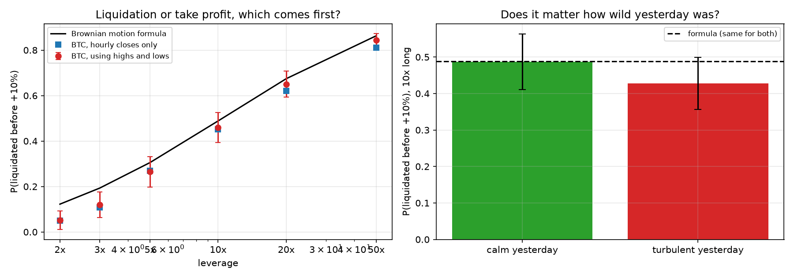

# Gambler's ruin on a leveraged long

A leveraged long is kind of just a bet with two exits, take profit or get liquidated. That's the gambler's ruin setup, so I tried the classic version and then checked it against a 10x Bitcoin long.

## The classic version

Start with 50 chips, win or lose one a round, stop at 100 or zero. With a fair coin you get to 100 half the time. With a 49 percent coin it's about 12 percent, which was more of a drop than I expected. At roulette, betting one chip at a time gets you to 100 about 6 percent of the time, and betting everything on one spin gets you there about 49 percent of the time.

## Bitcoin

I opened a long every day at midnight from September 2019 to August 2026, about 2,500 trades on hourly Binance US prices, with a take profit at plus 10 percent and liquidation at roughly one over the leverage below entry.

The continuous formula says the chance of getting liquidated first is just the distance to the take profit over the total distance between the exits. It doesn't care about volatility at all.



It mostly held up. At 10x it says 48.8 percent and Bitcoin came in at 45.9, inside the noise. From 5x to 50x it was within about four points.

I'd guessed Bitcoin would get liquidated more than the formula says, since in an earlier project its daily lows ran further than its highs. That didn't really happen. It was slightly less at every leverage, probably just because Bitcoin went up a lot over this stretch and the formula assumes no drift.

Using hourly closes instead of the actual highs and lows misses a few liquidations at high leverage, around three points at 20x and 50x, and doesn't matter at low leverage.

I also checked whether a turbulent day before entry changed anything. After calm days 48.7 percent got liquidated, after turbulent days 42.7. That's about one standard error apart, so not much to say there.

Nothing dramatic overall. The simple formula is a decent guide and most of the gap is probably drift.

## Limits

The trades overlap so they aren't independent, and the error bars are rough, especially at 2x and 3x where a lot of trades took months or never finished within 90 days. Liquidation prices are approximate and fees and funding are ignored.

## Run it

```
python src/fetch_data.py
python src/ruin.py
python src/btc_ruin.py
```

Needs numpy, pandas, matplotlib and requests.
