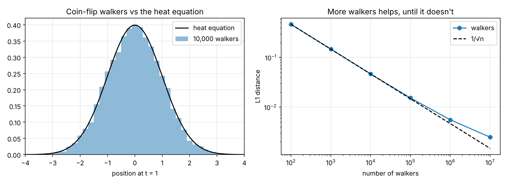
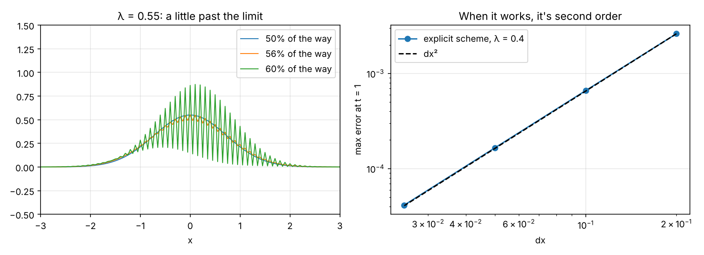
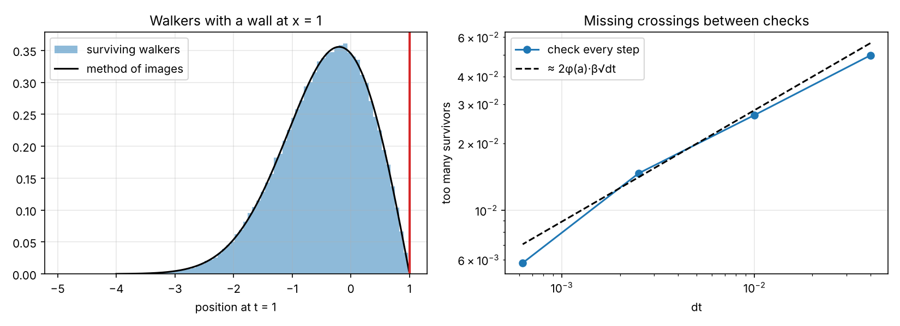

# Random walkers and the heat equation

I learned the heat equation in differential equations and finite differences in numerical analysis, and at no point did anyone mention that the heat equation is also just a crowd of people flipping coins. It came up again when I was working through Itô calculus, and I decided I had to check it myself.

## Coin flippers

Each walker steps left or right by the square root of dt with equal chance. After a while the crowd should be spread out exactly like heat from a point source, which is a normal curve with variance t.



It is. With 100 walkers the histogram is a mess, and by 10,000 it's hard to tell apart from the curve. The error falls like one over the square root of the number of walkers, until somewhere around a million it starts to level off. More walkers can't fix the fact that 100 coin flips aren't exactly a normal distribution. Only smaller steps can.

The one thing that tripped me up was the histogram coming out with every other bar empty. After an even number of steps a walker can only be on every other grid point, so the bins need to be twice as wide. Riveting stuff.

## Solving it on a grid

The explicit scheme from numerical analysis updates each grid point using its two neighbours. The textbook says it's stable as long as a number called lambda, which is half of dt over dx squared, stays at or below one half.



At 0.4 it works fine, and the error falls with the square of the grid spacing, which it's supposed to. At 0.55 it blows up into a sawtooth and ends with an error of about ten billion.

At 0.51 it looked completely fine and I nearly moved on. It turns out it just hadn't had time. Just past the limit the bad wave only grows by about 4 percent a step, and starting from rounding error that takes a while. Running it ten times longer, the error was 10 to the 48. So the rule is real, it's just patient.

## Adding a wall

Then I put a wall at x equals 1 that removes any walker who touches it. The PDE version keeps the solution at zero on the wall, and the neat way to solve it is to put a negative copy of the starting point at the mirror image across the wall, so the two cancel there. That's the reflection principle from an earlier project, just written as a PDE.



The surviving crowd matches the mirror formula. The surviving fraction should be 0.683, but my walkers survived too often, 0.732 with the biggest time step. That's because I only check for the wall at each step, so a walker can cross and come back in between and I never notice. It's the same thing I ran into with Bitcoin's daily high.

The fix is to nudge the wall slightly towards the walkers, by 0.58 times the square root of dt, so the discrete check catches about as many as the real wall would. I moved it the wrong way first, which made it worse, which in hindsight was obvious. Moved the right way, the error at the biggest step went from about 5 percent to about 0.3.

## Run it

```
python src/walkers.py
python src/explicit.py
python src/barrier.py
```

No data needed. Needs numpy, scipy and matplotlib. The wall script takes about 20 seconds.
