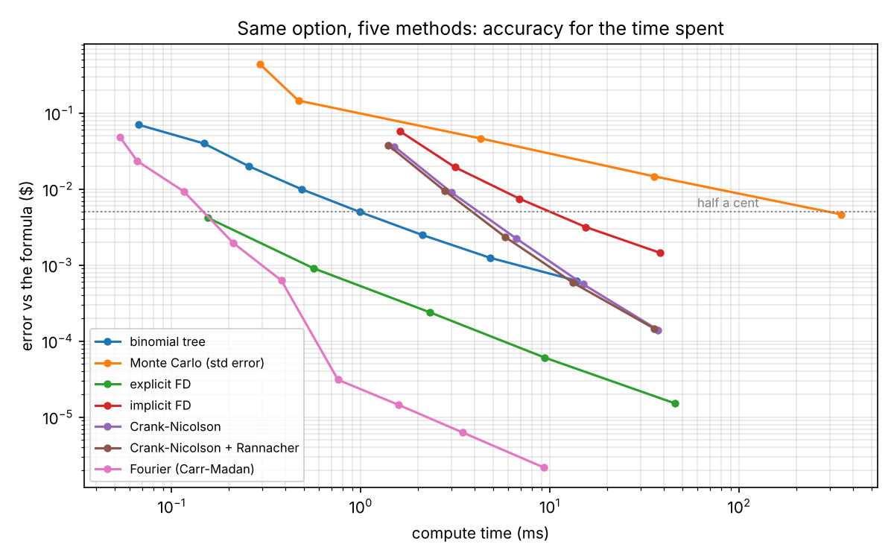
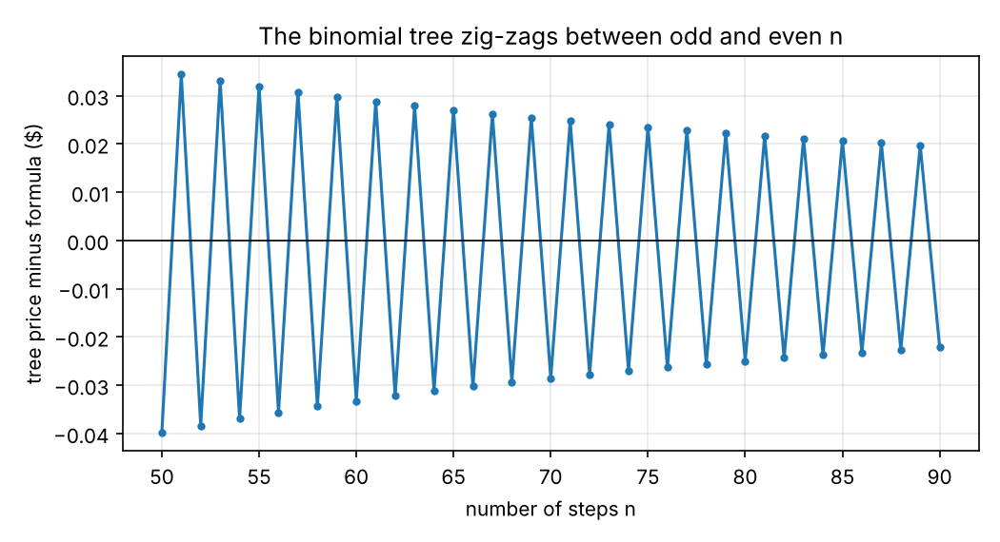

# One option, five methods

By this point I had priced options with a formula and with simulated paths, solved the heat equation on a grid and done the Fourier trick with dice, and I knew about binomial trees. They're all supposed to give the same answer for a plain European call, so I lined them up on one option to see which one actually gets there fastest. A one-year at-the-money call, 20 percent volatility, 5 percent rates. The formula says 10.4506.



They all get there eventually. The interesting part is how long it takes each one to get within half a cent.

Fourier won without much of a contest. The Carr-Madan version of the dice trick from project 01 got within half a cent in a fraction of a millisecond and kept going down to a few thousandths of a cent. It only needs the characteristic function, which for Black-Scholes is one line.

Monte Carlo came last by a long way. A third of a second and ten million paths to get within half a cent, because the error only falls like one over the square root of the number of paths. It's the method that works for almost anything, and you pay for that here.

The binomial tree sits in the middle and zig-zags the whole way. Odd and even numbers of steps land on opposite sides of the right answer, depending on whether the strike falls on a node or between two. I'd read about this but it's more dramatic than I expected.



The finite difference results were the part that didn't go to plan. Crank-Nicolson is the one everyone recommends, second order in both space and time, and I expected it to win that group. The plain explicit scheme beat it. Explicit has to take tiny time steps to stay stable, which I spent all of project 07 learning, but those tiny steps also make it very accurate, and each step is just arithmetic on an array with no system to solve. The textbook ranking assumes you get to choose your time step, and with explicit you don't. I also tried the Rannacher fix for the kink in the payoff, and it changed basically nothing for the price. Apparently it matters for the Greeks, which I didn't check.

None of this says one method is best in general. Fourier needs a characteristic function, trees and grids struggle in more than a couple of dimensions, and Monte Carlo is slow but doesn't care how complicated the product is. For this one option though, the ranking is pretty clear.

## Run it

```
python src/compare.py
```

No data needed. Needs numpy, scipy and matplotlib. The timings depend on the machine, so yours will be different, but the shape of the plot shouldn't be.
