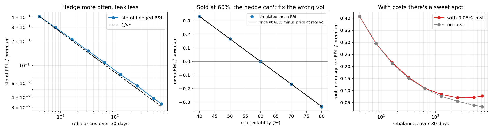
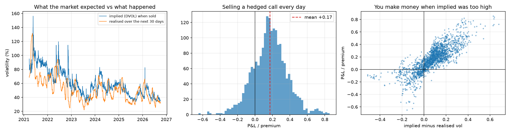

# How much does a delta hedge leak?

I'd priced options plenty of times by now but never actually hedged one, which is the whole point of the Black-Scholes argument. So I sold some and hedged them, first in a simulation where I control everything, then on real Bitcoin using Deribit's implied volatility.

## In a simulation

A 30-day at-the-money call on something with 60 percent volatility, sold and then delta hedged.



Hedging more often helps, but only like one over the square root of the number of rebalances. Hedging once a week leaves an error of about 41 percent of the premium, hourly gets it down to about 3. I'd half expected one over n, but a stale hedge loses on big moves and wins on small ones and those only average out, they don't cancel.

If the market's real volatility isn't the one I sold at, the hedge can't help. Selling at 60 when the market actually moves at 80 loses about a third of the premium however carefully I hedge, and the simulated loss matches the difference between the two option prices almost exactly. Hedging takes out the direction of the price, not how much it wiggles.

With a 0.05 percent cost per trade there's a sweet spot at about every three hours. Any more often and the costs eat what the extra accuracy saves.

## On real Bitcoin

Every day from March 2021 to October 2026 I sold a 30-day at-the-money call at Deribit's DVOL, which is basically the VIX for Bitcoin, and hedged it every hour along the real Binance price. DVOL for a day isn't known until the day ends, so I always used the previous day's value. About 2,000 trades.



Implied volatility averaged 59.8 percent and realised came in at 51.7, and implied was higher on about three quarters of days. So selling a hedged call every day made about 17 percent of the premium on average, and 81 percent of trades made money. The worst one lost 65 percent of its premium, so it's not free money, just paid.

It's also been shrinking. It made around 22 to 24 percent in 2021 and 2022, then 19 and 16, and about 9 to 12 in 2025 and 2026. The gap between implied and realised went from about 17 points to about 1 over the same stretch, which I guess is what happens when more people start selling.

One thing I can't fully explain is that 2026 still made about 12 percent with only a one point gap. My best guess is that realised vol measured from hourly prices is inflated by the price bouncing around, which I ran into in an earlier project, so the real gap is probably bigger than it looks. I haven't tested that.

## Limits

No trading costs in the real version, and the simulation suggests hourly rebalancing at 0.05 percent would cost something like 6 or 7 percent of the premium, which is most of the recent edge. DVOL is an index and not a price you could actually sell at, and I priced off Binance spot rather than Deribit's own index. The trades overlap, so the error bars are rough.

## Run it

```
python src/fetch_prices.py
python src/fetch_dvol.py
python src/simulate.py
python src/real_hedge.py
```

Needs numpy, scipy, pandas, matplotlib and requests.
