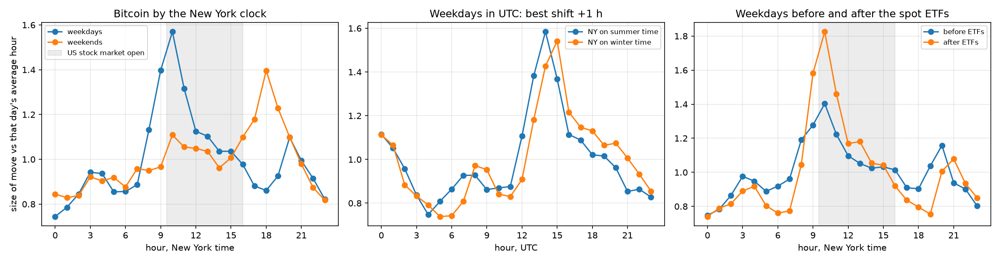

# Does Bitcoin keep New York hours?

I spent the summer in New York and I live in Boston, so my whole year runs on New York's clock, which jumps an hour twice a year. From the first Sunday in November to the second Sunday in March it's on winter time, five hours behind UTC instead of four. Bitcoin doesn't care about any of that. It trades around the clock and every exchange stamps its data in UTC.

That made a nice test for a question I left hanging in my first paper. I'd found that Bitcoin's volatility runs on a 24-hour cycle and guessed it followed the US stock market, but I never checked. If Bitcoin's busy hour really belongs to New York, it should move by an hour in UTC every time the clocks change where I live. If it belongs to nobody in particular, it should stay put.

Europe also makes it a bit better. The US and Europe change their clocks on different weekends, so for a few weeks a year New York has moved and London hasn't. Whichever one Bitcoin follows in those weeks is the one it's actually listening to.

I used hourly Binance US prices from September 2019 to October 2026 and divided each hour's move by that day's average hour, so a few wild months don't drown out everything else.



On weekdays the busiest hour by New York's clock is 10 to 11 in the morning, about 1.6 times an average hour, with 9 and 11 right behind it. That's the US stock market opening at 9:30. Weekends were the surprise. The busiest weekend hour is 6pm New York time, at about 1.4 times average. My guess is that's when the CME's Bitcoin futures reopen on Sunday evening, but I haven't checked that properly.

The clock change worked better than I expected. Measured in UTC, the weekday peak sits at 14:00 in summer and 15:00 in winter, and the best way to line the two patterns up is a shift of exactly one hour. So Bitcoin does move its schedule when New York does.

The weeks when New York and London disagree were less tidy. The pattern looks more like New York's than London's, but not by much, and the single busiest hour landed where London's schedule would put it. Only about 150 days fall in those gaps, so I'd call it leaning New York rather than settled.

Last thing, the US spot ETFs launched in January 2024. Before that, the New York opening hour was about 1.4 times average. Since then it's about 1.8. Meanwhile the 8 to 9am hour, when a lot of US economic data comes out, got quieter. Plenty of other things changed after 2024 too, so it's not proof, but it's at least the direction you'd expect if Bitcoin now trades partly through the stock market.

## Limits

One exchange, hourly data, so I can't separate 8:30 data releases from the 9:30 open very well. Dividing by each day's average is a fairly blunt way to deal with changing volatility. And the weekend 6pm thing is a guess.

## Run it

```
python src/fetch_data.py
python src/hours.py
```

Needs numpy, pandas, matplotlib and requests.
