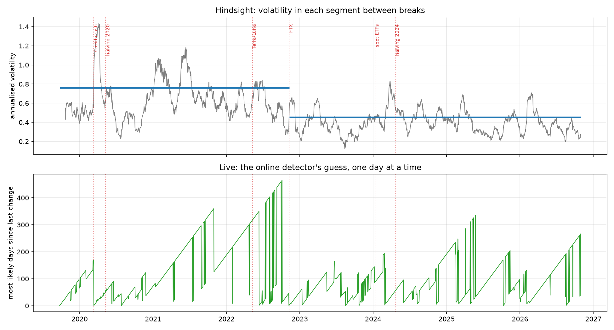

# When did Bitcoin change?

After the Markov chain project I knew Bitcoin had regimes that could last weeks, so the obvious follow-up was to find the actual days it switched. I tried two ways. One looks at all seven years at once, which is accurate but cheating, since it uses the future. The other reads one day at a time and only knows the past, which is how you'd actually have to do it. I wanted to see whether the breaks line up with things people always point to, like Covid, FTX, the halvings and the ETFs.

## The two methods

The hindsight one is a CUSUM test. If volatility never changed, the running total of squared returns would grow in a straight line, and a change puts a kink in it. Find the biggest kink, split there, repeat. The textbook version assumes normal returns, and with Bitcoin's tails every rough week looked like a break, so I used the actual fourth moment instead.

The live one is Bayesian online changepoint detection. Each day it keeps a probability for how many days it's been since the last change, and I count it as noticing something when it's 80 percent sure there was a change in the last month.

I set every threshold on fake data with three breaks I'd planted myself, where both methods found exactly those three, and then ran it on Bitcoin once. Adjusting things on Bitcoin until the breaks landed on the events I wanted would have been the leakage project all over again.



## What it found

The hindsight test found one break in seven years, on 10 November 2022, two days after FTX started falling apart. Before it, volatility ran at about 76 percent a year. After it, about 45, and it's stayed there since. Covid, the halvings and the ETF launch didn't show up as breaks at all. Covid was a huge spike but not a lasting change, and once the test stops treating fat tails as news, a spike isn't enough.

The live detector caught Covid on the day, 12 March 2020, and placed the start one day earlier. So that part works.

It completely missed FTX though. It didn't notice anything until 67 days later. I think the reason is that one enormous day is instant proof that volatility went up, but proof that it went down only builds up slowly, one quiet day at a time. So it's quick on panic and slow on calm, which is a bit backwards if the calm is the change that lasts.

It was also a lot twitchier on Bitcoin than on my fake data, with 13 detections instead of 3. My fake data jumped between fixed volatility levels, and real Bitcoin drifts around constantly, so plenty of short bursts look like changes.

## Limits

The live model assumes volatility is constant within a regime, which Bitcoin clearly isn't. The event dates are when things started, and the market didn't necessarily react on that exact day. One exchange, daily data.

## Run it

```
python src/fetch_data.py
python src/breaks.py
```

Needs numpy, scipy, pandas, matplotlib and requests.
